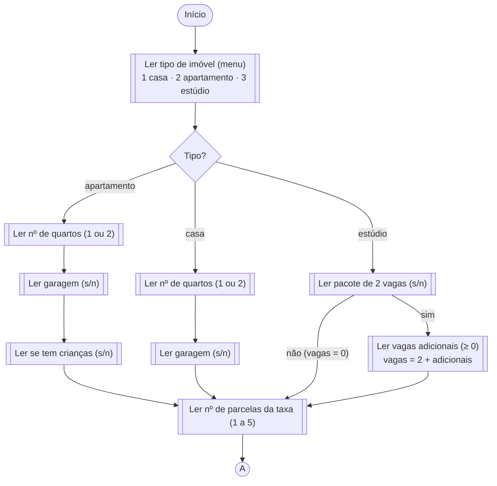
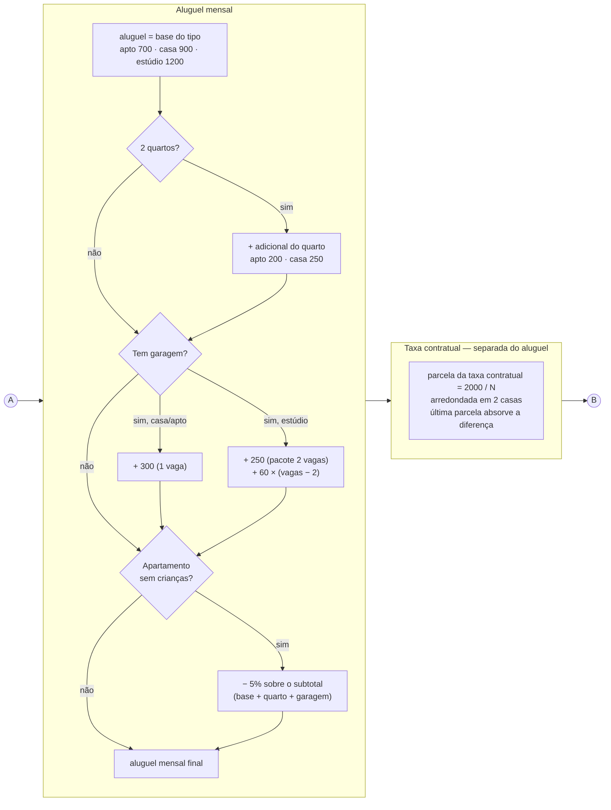
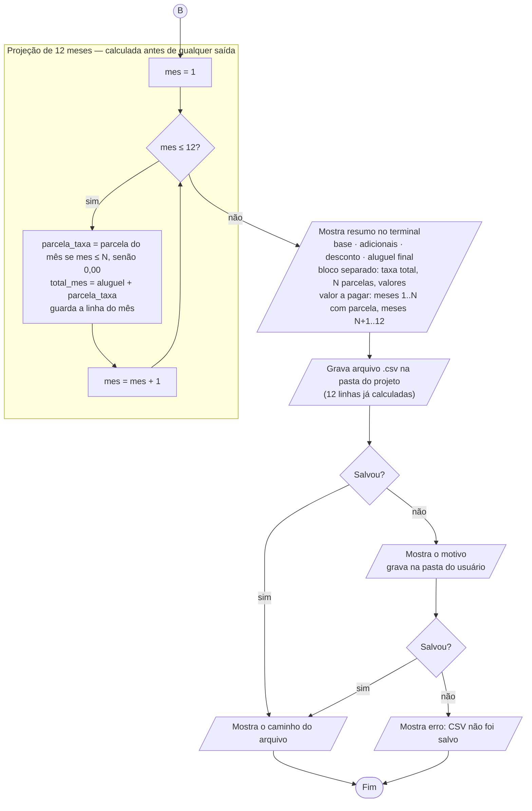
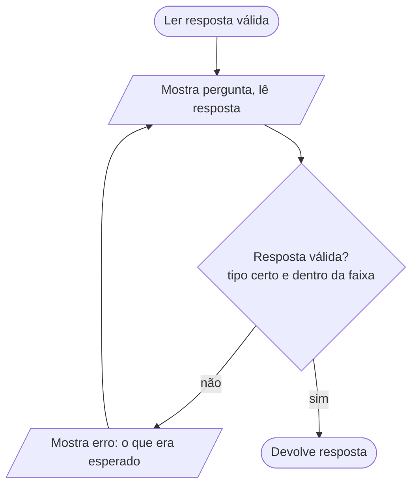

# RentSmart — Fluxograma

> Fluxo do programa: entradas, cálculo do aluguel, taxa contratual e saídas. Caixas com borda dupla `[[ ]]` = sub-processo
> "Ler resposta válida" (diagrama 2), reaproveitado em toda pergunta.
>
> O fluxo principal está dividido em 3 partes ligadas por conectores: o círculo **A** no fim da parte 1.1
> continua no círculo **A** do início da parte 1.2, e assim por diante.

## 1. Fluxo principal

### 1.1 Entrada de dados

### 1.2 Cálculo: aluguel mensal e taxa contratual

### 1.3 Projeção de 12 meses e saídas

## 2. Sub-processo: Ler resposta válida

