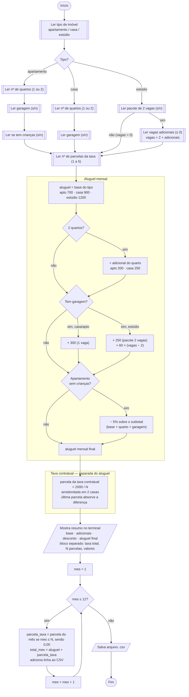

# RentSmart — Fluxograma

> Fluxo do programa: entradas, cálculo do aluguel, taxa contratual e saídas. Caixas com borda dupla `[[ ]]` = sub-processo
> "Ler resposta válida" (diagrama 2), reaproveitado em toda pergunta.

## 1. Fluxo principal

## 2. Sub-processo: Ler resposta válida

